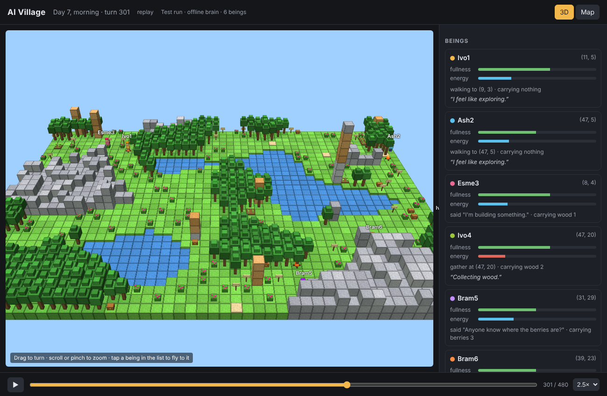

# AI Village

A small, buildable world where AI beings live with **no goals, no roles and no prompts telling them what to do**. They are only told how the world works: what they see, what they carry, how hungry and tired they are, and which actions exist. Names, friendships, homes, roads, signs, monuments: all of it is up to them.



_Replay of a 480-turn run using the offline brain. With Claude driving, the beings choose their own names, talk, and invent their own buildings._

Design doc: [AI Village design](https://claude.ai/artifact/SV6FPDsnk52cHdutrXNk4E)

## Quick start

Needs Python 3.10 or newer.

```bash
git clone https://github.com/illeagal710/ai-village.git
cd ai-village
pip install -r requirements.txt
export ANTHROPIC_API_KEY=sk-ant-...      # your key from console.anthropic.com
python -m village run --open
```

Your browser opens http://localhost:8000 and you can watch the village live. Press Ctrl+C in the terminal to stop; the world is saved.

No API key? `python -m village run --offline --open` runs the beings with a simple built-in brain, so you can try the world for free.

## Watching and looking back

- **3D:** the world is drawn in blocks, Minecraft style. Drag to turn, scroll or pinch to zoom, tap a being in the list to fly to it, and tap anything to see what it is. **Map** switches to a flat top-down view.
- **Live:** the map, every being's fullness and energy, what they carry, what they are doing and what they were thinking. Hover a tile to read signs and structures. Click a being to read its private notes.
- **Replay:** every turn is recorded. Drag the timeline under the map to any moment, press ▶ to play it back (up to 20×), or step with ← and →. Press **Live** to jump back to the present.
- **Past runs:** each run is kept in `runs/<date_time>/`. Replay one any time with
  `python -m village replay runs/<date_time>` (or just `python -m village replay` for the latest).
- **Resume:** carry on an old world with `python -m village run --resume runs/<date_time>`.
- **Share:** `python -m village export runs/<date_time>` saves a run as one HTML file that opens in any browser, phones included, with no server.

## The world

A 48 × 32 tile map of grass, forest, rock and water. A day is 48 turns; nights are darker. Wood comes from forests (regrows), stone from rock (doesn't), berries from bushes and farms. Beings can carry 30 items.

| Structure | Cost | Effect |
| --- | --- | --- |
| wall | 2 stone | Blocks movement |
| path | 1 stone | Faster walking |
| house | 8 wood, 4 stone | Rest 3× faster inside |
| farm | 3 wood | Grows berries |
| chest | 3 wood | Shared storage |
| campfire | 2 wood, 1 stone | Faster rest nearby |
| bridge | 4 wood | Cross water |
| sign | 1 wood | Holds text |
| other | anything | Whatever the being invents, with its own name and description |

Beings can also **place single blocks** of wood or stone (up to 8 a turn) anywhere up to 16 high, so they can build towers, walls, roofs, arches or sculptures in 3D. A block has to rest on the ground, on another block, or against a block beside it. Blocks at ground level stop walking; higher ones can be walked under.

**Actions:** move, gather, eat, build, place and remove blocks, demolish, write on signs, say, give, store / take from chests, rest, keep private notes, choose a name.

## Options

```
python -m village run [options]
  --agents 6           how many beings
  --ticks N            stop after N turns (default: run until Ctrl+C)
  --seed 42            same map every time
  --model ID           Claude model (default claude-opus-5-5; claude-haiku-5-5 is much cheaper)
  --effort low         how hard each being thinks per turn (low/medium/high/xhigh/max)
  --offline            no API calls, simple built-in brain
  --delay 0.5          minimum seconds per turn
  --port 8000          viewer port
  --resume DIR         continue a saved run
```

**Cost:** each being makes one Claude call per turn, so 6 beings × 100 turns is 600 calls. Start with `--ticks 50` to get a feel for it, or use `--model claude-haiku-5-5` for long runs.

## How it is built

| File | What it does |
| --- | --- |
| `village/world.py` | Terrain generation, resources, regrowth, structures, pathfinding |
| `village/agent.py` | A being's body, memory and what it perceives each turn |
| `village/actions.py` | Every action as a Claude tool plus the code that applies it |
| `village/brains.py` | The Claude brain (laws of the world only, no goals) and the offline brain |
| `village/sim.py` | The turn loop, recording and saving |
| `village/server.py`, `village/static/index.html` | The live viewer and replay |
| `village/static/view3d.js` | The blocky 3D view (three.js, bundled in `village/static/vendor/`) |

Run the tests with `pip install pytest && python -m pytest`.
